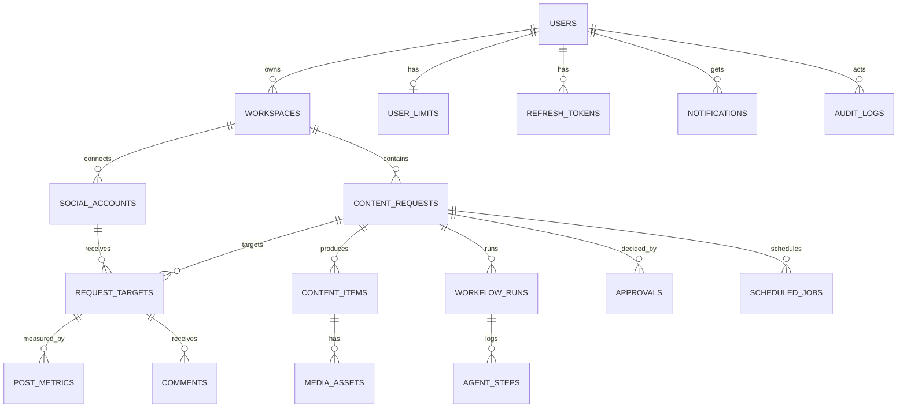

# DATABASE — Schema Design

> PostgreSQL 16. Managed by Alembic (`backend/alembic`). LangGraph checkpoint tables are created by the library (`setup()`), not by Alembic.
> Requirements: `PRD.md`. Behaviour: `ARCHITECTURE.md`.

---

## 1. Conventions

- Primary keys: `id UUID` (generated app-side, `uuid4`), unless noted.
- Timestamps: `timestamptz`, stored in **UTC**. Every table has `created_at`; mutable tables also have `updated_at`.
- Enums: implemented as PostgreSQL enums or `text` + CHECK (pick one in B1-04 and stay consistent). Values listed below are the contract.
- Soft delete only where stated (`deleted_at`). Foreign keys use `ON DELETE` as stated.
- Secrets (tokens) stored **encrypted** (`*_enc` columns, Fernet). Never plaintext.
- Names: `snake_case`, plural table names.
- **Never edit an applied migration.** Add a new one.

## 2. Entity relationship overview

## 3. Enums

| Enum | Values |
|---|---|
| `user_role` | `user`, `admin` |
| `platform` | `facebook`, `instagram`, `tiktok`, `youtube` |
| `account_status` | `active`, `expired`, `revoked`, `error` |
| `content_type` | `post`, `video` |
| `request_status` | `queued`, `generating`, `needs_attention`, `awaiting_approval`, `scheduled`, `held`, `publishing`, `published`, `partially_published`, `failed`, `rejected`, `cancelled` |
| `target_status` | `pending`, `publishing`, `published`, `failed`, `skipped` |
| `content_item_status` | `draft`, `approved`, `rejected`, `superseded` |
| `media_type` | `image`, `video`, `audio`, `subtitle`, `thumbnail` |
| `run_status` | `running`, `paused`, `completed`, `failed`, `cancelled` |
| `step_verdict` | `passed`, `failed`, `retried`, `escalated`, `error` |
| `approval_decision` | `approved`, `rejected`, `edited` |
| `job_type` | `start_generation`, `publish`, `collect_metrics`, `refresh_token` |
| `job_status` | `pending`, `running`, `done`, `failed`, `cancelled` |
| `notification_type` | `ready_for_approval`, `needs_attention`, `held`, `published`, `partially_published`, `publish_failed`, `account_expired`, `system` |

## 4. Tables

### 4.1 `users`
| Column | Type | Constraints / notes |
|---|---|---|
| id | uuid | PK |
| email | citext / text | UNIQUE, NOT NULL, lowercase |
| password_hash | text | NOT NULL |
| full_name | text | |
| role | user_role | NOT NULL default `user` |
| is_active | bool | NOT NULL default true |
| last_login_at | timestamptz | |
| created_at, updated_at | timestamptz | |

### 4.2 `refresh_tokens`
| Column | Type | Notes |
|---|---|---|
| id | uuid | PK |
| user_id | uuid | FK users ON DELETE CASCADE |
| token_hash | text | UNIQUE (hash of token, never the token) |
| expires_at | timestamptz | |
| revoked_at | timestamptz | null = valid |
| created_at | timestamptz | |

Also used for password reset tokens via a `purpose` column (`refresh` \| `password_reset`).

### 4.3 `user_limits`
| Column | Type | Notes |
|---|---|---|
| user_id | uuid | PK, FK users ON DELETE CASCADE |
| max_workspaces | int | default from system_settings if null |
| max_accounts_per_workspace | int | |
| monthly_generation_limit | int | |
| updated_at | timestamptz | |

### 4.4 `workspaces`
| Column | Type | Notes |
|---|---|---|
| id | uuid | PK |
| owner_id | uuid | FK users ON DELETE RESTRICT, NOT NULL |
| name | text | NOT NULL; UNIQUE (owner_id, name) where deleted_at is null |
| description | text | |
| brand_voice | text | tone/style guidance for agents |
| default_language | text | default `en` |
| timezone | text | IANA name, default `UTC` |
| default_platforms | platform[] / jsonb | |
| settings | jsonb | extra per-workspace options |
| is_suspended | bool | admin action, default false |
| deleted_at | timestamptz | soft delete |
| created_at, updated_at | timestamptz | |

### 4.5 `social_accounts`
| Column | Type | Notes |
|---|---|---|
| id | uuid | PK |
| workspace_id | uuid | FK workspaces ON DELETE CASCADE |
| platform | platform | NOT NULL |
| platform_account_id | text | page id / IG business id / channel id / TikTok open id |
| display_name | text | label shown to user |
| access_token_enc | text | Fernet ciphertext |
| refresh_token_enc | text | |
| token_expires_at | timestamptz | |
| scopes | text[] | |
| status | account_status | default `active` |
| last_error | text | |
| connected_at | timestamptz | |
| disconnected_at | timestamptz | set on disconnect (row kept for history) |
| meta | jsonb | platform-specific extras (e.g. linked FB page for IG) |
| created_at, updated_at | timestamptz | |

UNIQUE (workspace_id, platform, platform_account_id) where `disconnected_at is null`.

### 4.6 `content_requests`
| Column | Type | Notes |
|---|---|---|
| id | uuid | PK (also LangGraph `thread_id`) |
| workspace_id | uuid | FK workspaces ON DELETE CASCADE |
| created_by | uuid | FK users |
| topic | text | NOT NULL |
| content_type | content_type | NOT NULL |
| publish_at | timestamptz | NOT NULL |
| status | request_status | NOT NULL default `queued` |
| status_reason | text | last transition reason / error summary |
| plan | jsonb | planner output snapshot |
| strategy | jsonb | strategist output snapshot |
| review | jsonb | last reviewer verdict |
| options | jsonb | extra user options (tone override, language, etc.) |
| approved_at | timestamptz | |
| published_at | timestamptz | |
| cancelled_at | timestamptz | |
| created_at, updated_at | timestamptz | |

### 4.7 `request_targets`
| Column | Type | Notes |
|---|---|---|
| id | uuid | PK |
| request_id | uuid | FK content_requests ON DELETE CASCADE |
| social_account_id | uuid | FK social_accounts ON DELETE RESTRICT |
| platform | platform | denormalised for convenience |
| status | target_status | default `pending` |
| platform_post_id | text | set on success |
| post_url | text | |
| error_message | text | |
| retry_count | int | default 0 |
| published_at | timestamptz | |
| created_at, updated_at | timestamptz | |

UNIQUE (request_id, social_account_id). Idempotency rule: never publish when `status='published'` or `platform_post_id` is set.

### 4.8 `content_items`
| Column | Type | Notes |
|---|---|---|
| id | uuid | PK |
| request_id | uuid | FK content_requests ON DELETE CASCADE |
| platform | platform | content format key (one item per platform per version) |
| version | int | starts at 1; +1 on regenerate; users' edits update the current version |
| kind | content_type | |
| title | text | video/YouTube title |
| caption | text | post body / description |
| hashtags | jsonb | list of strings |
| script | jsonb | video only |
| storyboard | jsonb | video only |
| status | content_item_status | default `draft` |
| edited_by_user | bool | default false |
| warnings | jsonb | reviewer warnings shown on preview |
| created_at, updated_at | timestamptz | |

UNIQUE (request_id, platform, version).

### 4.9 `media_assets`
| Column | Type | Notes |
|---|---|---|
| id | uuid | PK |
| content_item_id | uuid | FK content_items ON DELETE CASCADE |
| type | media_type | |
| storage_key | text | NOT NULL (key in StorageBackend) |
| mime_type | text | |
| size_bytes | bigint | |
| duration_seconds | numeric | audio/video |
| width, height | int | image/video |
| position | int | order (e.g. scene number) |
| meta | jsonb | prompts used, provider, seed |
| created_at | timestamptz | |

### 4.10 `workflow_runs`
| Column | Type | Notes |
|---|---|---|
| id | uuid | PK |
| request_id | uuid | FK content_requests ON DELETE CASCADE |
| thread_id | text | LangGraph thread id (= request id) |
| status | run_status | |
| started_at, finished_at | timestamptz | |
| error | text | |
| summary | jsonb | counts of retries, escalations, total tokens/cost |
| created_at | timestamptz | |

A new run row is created each time generation is (re)started (initial, regenerate, resolve-retry).

### 4.11 `agent_steps`
| Column | Type | Notes |
|---|---|---|
| id | uuid | PK |
| run_id | uuid | FK workflow_runs ON DELETE CASCADE |
| request_id | uuid | denormalised, indexed |
| node_name | text | e.g. `writer`, `check_writer`, `scene:2` |
| attempt | int | 1-based |
| verdict | step_verdict | |
| feedback | text | checker feedback passed to next attempt |
| input_summary | jsonb | trimmed (no secrets) |
| output_summary | jsonb | trimmed |
| tokens_in, tokens_out | int | |
| cost_usd | numeric(12,6) | |
| latency_ms | int | |
| model | text | |
| created_at | timestamptz | |

### 4.12 `approvals`
| Column | Type | Notes |
|---|---|---|
| id | uuid | PK |
| request_id | uuid | FK content_requests ON DELETE CASCADE |
| content_item_id | uuid | FK content_items (nullable for request-level decisions) |
| user_id | uuid | FK users |
| decision | approval_decision | |
| feedback | text | reject reason / edit note |
| regenerate | bool | for rejections |
| created_at | timestamptz | |

Publishing requires at least one `approved` row for the request (enforced in service layer).

### 4.13 `scheduled_jobs`
| Column | Type | Notes |
|---|---|---|
| id | uuid | PK |
| request_id | uuid | FK content_requests ON DELETE CASCADE (nullable for system jobs such as token refresh) |
| social_account_id | uuid | nullable, for `refresh_token` / `collect_metrics` scoping |
| job_type | job_type | |
| run_at | timestamptz | NOT NULL |
| status | job_status | default `pending` |
| attempts | int | default 0 |
| max_attempts | int | default 5 |
| last_error | text | |
| locked_at | timestamptz | set when picked; used to reclaim stale jobs |
| payload | jsonb | e.g. `{"offset": "24h"}` |
| created_at, updated_at | timestamptz | |

Poller query: `status='pending' AND run_at <= now() ORDER BY run_at FOR UPDATE SKIP LOCKED LIMIT n`.

### 4.14 `post_metrics` (snapshots)
| Column | Type | Notes |
|---|---|---|
| id | uuid | PK |
| target_id | uuid | FK request_targets ON DELETE CASCADE |
| fetched_at | timestamptz | NOT NULL |
| likes, comments_count, shares, views, reach, impressions | bigint | nullable (platform may not provide) |
| engagement_rate | numeric(6,3) | optional derived value |
| raw | jsonb | raw platform response (trimmed) |

### 4.15 `comments`
| Column | Type | Notes |
|---|---|---|
| id | uuid | PK |
| target_id | uuid | FK request_targets ON DELETE CASCADE |
| platform_comment_id | text | NOT NULL |
| author_name | text | |
| author_platform_id | text | |
| text | text | |
| commented_at | timestamptz | time on platform |
| fetched_at | timestamptz | |
| sentiment | text | optional, filled later |
| raw | jsonb | |

UNIQUE (target_id, platform_comment_id) (upsert on fetch).

### 4.16 `notifications`
| Column | Type | Notes |
|---|---|---|
| id | uuid | PK |
| user_id | uuid | FK users ON DELETE CASCADE |
| type | notification_type | |
| title | text | |
| body | text | |
| data | jsonb | ids for deep links (`request_id`, `account_id`) |
| read_at | timestamptz | null = unread |
| created_at | timestamptz | |

### 4.17 `system_settings`
| Column | Type | Notes |
|---|---|---|
| key | text | PK |
| value | jsonb | |
| description | text | |
| updated_by | uuid | FK users |
| updated_at | timestamptz | |

Known keys (defaults live in code): `max_retries_default` (3), `max_retries_scene` (2), `max_review_cycles` (2), `lead_time_minutes_post` (30), `lead_time_minutes_video` (120), `metrics_schedule`, `default_max_workspaces`, `default_max_accounts_per_workspace`, `default_monthly_generation_limit`, `model_text`, `model_fast`, `platform_rules` (per-platform limits; **verify against official docs**).

### 4.18 `moderation_rules`
| Column | Type | Notes |
|---|---|---|
| id | uuid | PK |
| rule_type | text | `banned_word` (extendable) |
| value | text | |
| is_active | bool | default true |
| created_by | uuid | FK users |
| created_at | timestamptz | |

### 4.19 `audit_logs`
| Column | Type | Notes |
|---|---|---|
| id | uuid | PK |
| actor_id | uuid | FK users (nullable for system) |
| action | text | e.g. `user.suspend`, `request.approve`, `settings.update` |
| entity_type | text | |
| entity_id | text | |
| meta | jsonb | before/after, ip, etc. (no secrets) |
| created_at | timestamptz | |

## 5. Indexes (minimum set)

| Table | Index | Why |
|---|---|---|
| users | UNIQUE (email) | login |
| workspaces | (owner_id) where deleted_at is null | list my workspaces |
| social_accounts | (workspace_id), (status, token_expires_at) | list; token refresh sweep |
| content_requests | (workspace_id, status), (workspace_id, created_at desc), (status, publish_at) | lists; held detection |
| request_targets | (request_id), (social_account_id), (status) | joins; publishing |
| content_items | (request_id, platform, version desc) | latest version |
| media_assets | (content_item_id, position) | ordered media |
| workflow_runs | (request_id, created_at desc) | latest run |
| agent_steps | (run_id, created_at), (request_id), (node_name, verdict) | monitoring, failure analysis |
| scheduled_jobs | (status, run_at), (request_id) | poller; cancel by request |
| post_metrics | (target_id, fetched_at desc) | latest metrics |
| comments | UNIQUE (target_id, platform_comment_id), (target_id, commented_at desc) | upsert; list |
| notifications | (user_id, read_at, created_at desc) | unread list |
| audit_logs | (entity_type, entity_id), (actor_id, created_at desc) | investigation |

## 6. Integrity rules (enforced in services, backed by constraints where possible)

1. A request's `target` accounts must belong to the request's workspace and be `active` at submit time.
2. `publish_at` must be in the future at submit/reschedule time.
3. `request_status` changes only through the transition function (see `ARCHITECTURE.md` section 4).
4. A request can reach `scheduled`/`publishing` only if an `approvals` row with `decision='approved'` exists for its current content.
5. Regenerating creates new `content_items` rows (`version + 1`) and marks the previous ones `superseded`; never overwrite history.
6. Disconnecting an account sets `disconnected_at` and `status='revoked'`; existing targets/metrics remain; pending targets for that account become `skipped` and the owner is notified.
7. Soft-deleting a workspace cancels its pending `scheduled_jobs` and sets its non-final requests to `cancelled`.
8. Quota checks (`user_limits` + `system_settings` defaults) run before creating workspaces, accounts and requests.

## 7. Retention

- `agent_steps.input_summary/output_summary` are trimmed summaries; keep full prompts out of the DB.
- `post_metrics`: keep all snapshots for 90 days, then keep one per day (optional janitor task).
- Media assets of cancelled/rejected requests can be purged after 30 days (optional janitor task).
- `audit_logs`: keep indefinitely in v1.

## 8. Seed data

- Admin user from `SEED_ADMIN_EMAIL` / `SEED_ADMIN_PASSWORD` (`make seed`, idempotent).
- Default `system_settings` rows inserted on first start if missing.

## 9. Migration plan (matches `TASKS.md`)

| Phase | Migration content |
|---|---|
| B1 | `users`, `refresh_tokens`, `user_limits`, `workspaces`, `audit_logs`, `system_settings` |
| B2 | `workflow_runs`, `agent_steps` |
| B3 | `social_accounts`, `content_requests`, `request_targets`, `content_items`, `media_assets`, `approvals`, `scheduled_jobs`, `post_metrics`, `comments`, `notifications` |
| B5 | `moderation_rules` and any index additions found necessary |
